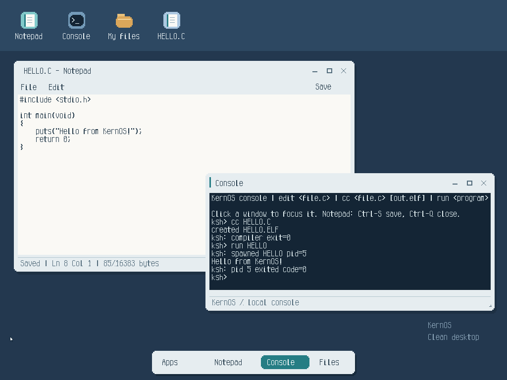

# KernOS

A hobby operating system for real hardware, written from its specs.
No GRUB, no tutorial code, no foreign bootloader: our MBR, our stage 2,
our kernel. The bottom half of the OS is dictated by the hardware; the
top half (ABI, libc, filesystem, shell, UI) is designed here, from a
blank page.



The actual KernOS desktop in QEMU: edit, save, compile and run C inside the OS.

## Status

KernOS boots into the Clean graphical desktop: working application/file
icons, overlapping movable and resizable windows, a dock, My files, a
userland Notepad editor, and an independent console. The Harbor palette
uses ink-blue wallpaper, warm white paper and teal active-window accents.
Save C source on
FAT32, compile with KCC (TinyCC), and run the resulting ELF program.
The automated test types source through PS/2, checks output and exit
status, introduces and corrects an error, and restarts the VM to reopen
the saved source. It also exercises loops, structs, variadic functions,
and floating literals. See [the plan and acceptance evidence](docs/DEVELOPMENT-WORKFLOW.md).

Twelve host suites (`make hosttest`, or `scripts/test-native.ps1`) cover fat32,
elf64, format, font, input, pmm, utf8, editor, terminal, and compiler
arena, PS/2 mouse direction/cursor edges, and desktop composition/input. The kernel includes scheduling, isolated process address spaces,
blocking syscalls, and eager x87/SSE context preservation.

## Building

On Windows with LLVM and the Visual Studio C build tools installed, build
and run directly without Docker:

```powershell
scripts\build-native.ps1  # builds the entire OS, libc and KCC locally
scripts\run.ps1           # opens native QEMU
scripts\test-native.ps1   # host regression suites
```

The Docker toolchain remains available (see [Dockerfile](Dockerfile)):

```powershell
scripts\build.ps1      # produces build/kernos.img
scripts\run.ps1        # opens native QEMU when installed; serial in terminal
scripts\run.ps1 -Headless  # native QEMU, without a graphical window
```

You can also double-click `build/KernOSLauncher.exe` in Explorer. The Windows
build script regenerates this launcher from `scripts/KernOSLauncher.cs`.
The graphical launchers use GTK with graphics acceleration disabled. The
installed Windows QEMU crashes in its SDL backend before the guest starts,
so SDL is not used. With the pointer over the VM, Ctrl-Alt-G toggles
mouse/keyboard capture so you can switch between KernOS and Windows.
Move up to move the guest pointer up; no inverted input setting is required.
The launcher records QEMU errors in `build/interactive-qemu.stderr` and
shows an error dialog if QEMU exits unsuccessfully.

Notepad opens `HELLO.C` on startup. Type source and press **Ctrl-S**.
Click Console in the dock, then enter:

```text
cc HELLO.C
run HELLO
```

Click Notepad in the dock to continue editing. Drag title bars to move
windows, use the bottom-right grip to resize, and use the title-bar
buttons to minimize, maximize/restore or close. Desktop icons reopen
windows; My files lists the real FAT32 root directory.

File menus provide New/Open/Save/Save as/Close; Edit provides selection,
cut/copy/paste. Mouse dragging selects text. **Ctrl-N/O/S/Q/A/X/C/V** and
arrow keys, Home/End, Delete, Backspace and Tab work. Unsaved changes
offer Save/Discard/Cancel; Save as asks before replacing an existing file.
The clipboard stays inside Notepad. Console `edit OTHER.C` opens that
document in the existing Notepad window. Console
commands also include `cat FILE`, `echo TEXT`, `help`, and `exit`.

Source is ASCII with short 8.3 filenames and a 16,383-byte limit. KCC
accepts one source file plus an optional output filename, e.g.
`cc HELLO.C HELLO.ELF`. Only the supplied small libc is available;
general user malloc, a math library, and floating printf formats are
not yet provided. See [KCC's port notes](kcc/README.md).

`build/ahcidisk.img` is the persistent filesystem. Ordinary builds and
`make clean` preserve it; stop the VM before rebuilding. `make reset-disk`
explicitly erases and recreates it. Acceptance tests use their own copy.
The boot disk alone contains no user programs or source filesystem.
Real hardware is unverified and currently needs legacy IDE boot media,
a separate AHCI filesystem disk, and PS/2 input; a USB-only boot setup
is not supported by this boot chain.

Run all acceptance checks inside the build container:

```text
make hosttest
make image
python3 tools/workflow-test.py
python3 tools/desktop-test.py
```

The native path uses `scripts/build-native.ps1 -TestOnly`,
`scripts/test-native.ps1`, then `node tools/desktop-native-test.mjs`.
The QEMU tests use disposable disk copies and never capture the desktop.
See [desktop behavior, architecture and limits](docs/DESKTOP.md).

## Layout

```
boot/       stage 1 (MBR) and stage 2 (A20, PIC remap, protected mode,
            direct disk load, persistent page tables, long mode)
kernel/     the kernel: start.s → main.c; scheduler + blocking
            syscall gate + procs (arch/x86_64), FAT32, ELF64 loader,
            input core; also the ELF users that ride the image
            (kernel/user: shell, editor, u1)
kcc/        TinyCC guest port, compatibility layer and build script
vendor/     TinyCC source and retained licensing notices
libc/       the userland libc: printf family (format.c host-tested),
            string, unistd (the syscall ABI as C)
obj/…       object/output paths under build/ (created by scripts)
include/    freestanding kernel types + host/test headers
tools/      host-side image assembler (mkimage), filesystem fixture
            builder (mkfat32), font packer (mkfont), QEMU gate
            driver, QMP input injectors, boot fraud self-checks
tests/      the host suites (make hosttest): fat32, elf64, format,
            font, input, pmm - each compiles the kernel's own module
docs/       roadmap, disk layout, syscall ABI, future ABI docs
```
